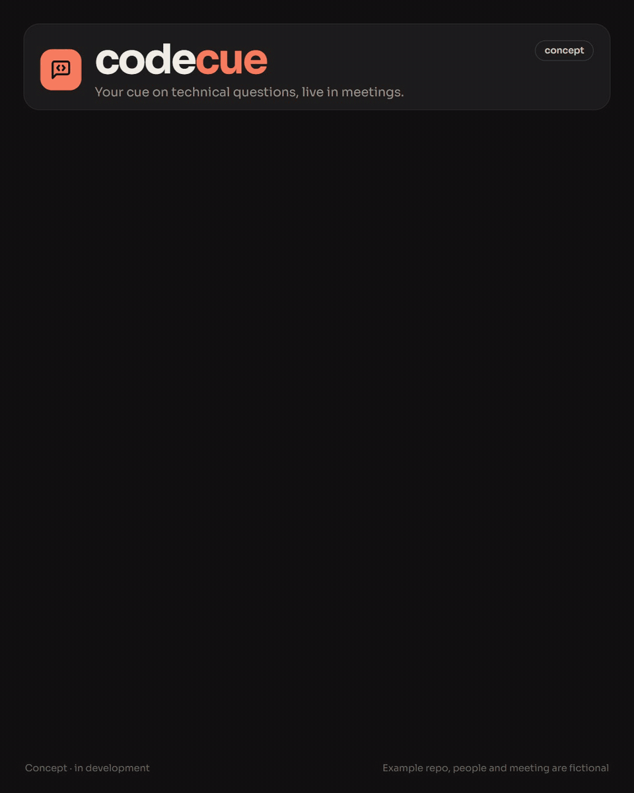

# Codecue flow video

A 15-second, 4:5 portrait (1080×1350) LinkedIn video. It shows the end-to-end flow of **Codecue**, a product concept. The video is an animated HTML page that is recorded frame by frame into an MP4 and a GIF.



These notes are the full handoff, so the work can continue on another laptop (with or without Claude Code). They cover what the video is, how it's built, why it looks the way it does, and what went wrong along the way.

- Finished files: [`out/codecue-flow.mp4`](out/codecue-flow.mp4) (0.9 MB, post this one) and [`out/codecue-flow.gif`](out/codecue-flow.gif) (3 MB)
- Source: [`src/codecue-flow.template.html`](src/codecue-flow.template.html)

## Quick start

You need Node 20+ (built with Node 24) and Google Chrome installed. ffmpeg is bundled through `ffmpeg-static`.

```sh
npm install
npm run build     # src/ template + icons/avatars  ->  build/codecue-flow.html
npm run record    # build, then record             ->  out/codecue-flow.mp4 + out/codecue-flow.gif
```

- **Preview:** open `build/codecue-flow.html` in Chrome. It plays once and has a Replay button.
- **Stills at chosen moments** (quicker than a full recording when checking layout):
  ```sh
  STILLS=3300,7600,9800,15000 node scripts/record.mjs build/codecue-flow.html out 30 864 1080 1.25
  ```
  This writes `out/still-<ms>.png`. In PowerShell, run `$env:STILLS="3300,7600"` first.
- **Chrome path:** the scripts look for Chrome in the usual places on Windows, macOS and Linux. If yours is somewhere else, set `CHROME_PATH`.
- **Recording time:** a full recording is 450 frames (30 fps × 15 s) plus a 1-second hold on the last frame, and takes a few minutes.

## How it works

```
src/codecue-flow.template.html  --scripts/build.mjs-->  build/codecue-flow.html  --scripts/record.mjs-->  frames/*.jpg  --ffmpeg-->  .mp4 + .gif
     (layout, CSS, timeline)        inlines SVG assets      (self-contained page)      headless Chrome, 1 frame at a time
```

1. **Template.** The page is a fixed 864×1080 artboard (`.art`) that scales to fit the window. Tiles and items carry timing attributes (see "Editing the timeline"). Where the assets go there is a `/*ASSETS*/` placeholder.
2. **Build** (`scripts/build.mjs`). It replaces `/*ASSETS*/` with `const ASSETS = {av, br, ic}`, so the built page needs no network apart from Google Fonts:
   - `av`: four DiceBear **Notionists** avatars, generated from fixed seeds.
   - `br`: brand marks from **Simple Icons**: GitHub, Zoom, Google Meet, Adobe Acrobat Reader.
   - `ic`: **Lucide** icons. Add new icon names to the `names` list in `build.mjs`.

   At load, the page swaps `<i data-ic="name">`, `<i data-br="name">` and `<div data-av="name">` for inline SVG. Add `data-mono` to a brand mark to draw it in `currentColor` instead of the brand colour.
3. **The page is a pure function of time `t` (ms).** `render()` sets every class from `t`, so normal playback, recording and jumping to a time all agree. `END = 15000`.
4. **Recording** (`scripts/record.mjs`). Each frame:
   - Calls `window.__advance(1000/fps)`. That moves `t` forward, re-renders, and steps every CSS animation by the same amount: it pauses each animation from `document.getAnimations()` and sets its `currentTime`.
   - Takes a screenshot.

   This continues until `window.__done`. ffmpeg then makes:
   - an MP4: libx264, crf 18, preset slow, yuv420p, faststart, 30 fps;
   - a GIF from the MP4: 12 fps, 960 wide, 128-colour palette with Bayer dithering.

   Arguments: `<html> <outDir> [fps] [width] [height] [scale]`. The video uses `30 864 1080 1.25`, so 864×1080 × 1.25 gives 1080×1350.

### The page contract (reuse this for any new video)

The recorder works with any page that provides these hooks:

| Hook | Meaning |
|---|---|
| `window.__ready` | Set to `true` once fonts have loaded (`document.fonts.ready`) |
| `window.__show(_, ms)` | Pause and jump to time `ms` (used for stills) |
| `window.__advance(dt)` | Pause, move forward `dt` ms, re-render, and step CSS animations by `dt` |
| `window.__done` | Set to `true` when `t` reaches `END` |
| `#record` URL hash | Recording mode: full-bleed, no rounded frame, no Replay button |

To make a new video, copy the template, change the content and timeline, add any new icon names to `build.mjs`, and point `npm run build` / `record` at the new file.

## Editing the timeline

All times are milliseconds from the start.

| Attribute | Effect |
|---|---|
| `data-on="500"` | Gets class `on` (visible) from 500 ms onward |
| `data-on="5100-6100"` | `on` only between those times. Used for who's speaking: green ring plus sound meter |
| `data-on="7000-8400,11000-12000"` | Several ranges, separated by commas |
| `data-hl="500-2400"` | Coral highlight on a tile while it's the active step |
| `data-sel="1700"` | Gets class `sel` from that time (the selected repo row) |
| `data-at="8600" data-ms="20"` on `#answer` | The answer types out from 8.6 s at 20 ms per character |

Classes: `.tile` fades and slides in, `.pop` is a small item that pops in, and `.bub` is a transcript bubble that rises in (hidden until `on`).

### Current storyboard

| Time | What happens |
|---|---|
| 0.0 s | Header: coral mark (message-square-code icon), "code" + coral "cue" wordmark, the tagline "Your cue on technical questions, live in meetings.", and a "concept" pill |
| 0.5–2.4 s | **1 Connect your repo** (GitHub mark). Three repo rows; `clinic-booking` (with a lock icon) gets selected at 1.7 s; then "Copied to your laptop. Code stays with you." |
| 2.5–4.4 s | **2 Learns the project.** Chips: code / summary / your focus. Files: Q3-roadmap.pptx (P badge), Kickoff-minutes.docx (W badge), Vendor-report.pdf (Acrobat mark) |
| 4.5 s | **3 Listens to the call** ("works with" Zoom, Meet, Teams-T badge). A video-call window "Weekly sync · Meridian Health": a 2×2 grid of Sarah · client, Dr. Aminah, Daniel · dev (muted), You; plus a toolbar |
| 4.8 s | **Transcript** tile, LIVE |
| 5.1–6.1 s | Dr. Aminah speaks: "We launch in Johor next month." |
| 6.2–6.9 s | You speak, and the transcript shows "Your voice is not transcribed" |
| 7.0–8.4 s | Sarah asks "Can patients pay with FPX online banking?", which gets a **Question** flag at 8.0 s |
| 8.3–11.0 s | **4 Answers only you** (private). A light card types: "Not yet. Checkout takes cards only. Stripe supports FPX, so it's about 2–3 days to add." Sources: `checkout.ts`, roadmap · slide 4. Then "1.1 s" |
| 11.0–12.0 s | Sarah: "Could we get SMS reminders too?", which gets a **Feature request** flag |
| 12.0–13.8 s | **5 Becomes a PR.** "Spec: SMS reminders", `+ docs/feature-requests/sms-reminders.md`, "Waiting for your review", then a "Review on GitHub" button |
| 13.8–16 s | Everything stays on screen (`END` = 15 s, plus the recorder's 1-second hold) |
| Footer | "Concept · in development" and "Example repo, people and meeting are fictional" |

## Design system ("product bento")

- **Canvas:** 864×1080 artboard (4:5), 32 px outer margin, 16 px gaps, tiles with 22 px radius. Tile positions are inline `left/top/width/height` in px.
- **Colours** (CSS variables on `:root`):

  | Token | Value | Use |
  |---|---|---|
  | `--bg` | `#121212` | Page |
  | `--tile` | `#1d1d1d` | Tiles |
  | `--tile-2` | `#262626` | Rows inside tiles |
  | `--edge` | `#2b2b2b` | Tile borders |
  | `--text` | `#f2efe9` | Text |
  | `--muted` | `#9a958c` | Secondary text |
  | `--coral` | `#ff7a59` | Brand, step numbers, active highlight |
  | `--sand` | `#f5c26b` | Chips, question flag |
  | `--talk` | `#4cc38a` | Speaking ring and sound meter |
  | `--paper` | `#f2efe9` | Light answer card |

  Live dot, mute icon and the leave-call button use `#e5484d`.
- **Fonts:** Sora (400/600/700) for UI text and the wordmark; IBM Plex Mono (400/500) for file names, repos and timings. Both come from Google Fonts.
- **Wordmark:** "code" in text colour + "cue" in coral, Sora 700, letter-spacing −0.045em.
- **Avatars** (DiceBear Notionists, `seed` / background):

  | Person | Seed | Background |
  |---|---|---|
  | Sarah | `Wei` | `ffb39e` |
  | Dr. Aminah | `Arif` | `a8d8c8` |
  | Daniel | `Daniel` | `b9c7f0` |
  | You | `Kai` | `f5c26b` |

  To pick different people, run `node scripts/avatar-sheet.mjs out/avatars.html`, open the file, and change the seeds in `build.mjs`.
- **Microsoft marks:** Microsoft logos aren't in Simple Icons (or any free set), so Teams, PowerPoint and Word are letter badges in brand colours:
  - **T** `#5059c9`
  - **P** `#c43e1c`
  - **W** `#185abd`

## Licences

| Asset | Licence | Notes |
|---|---|---|
| DiceBear Notionists | CC0 | Free for commercial use |
| Simple Icons | CC0 | Brand marks still belong to their owners, so use them only to show compatibility |
| Lucide | ISC | |
| Sora, IBM Plex Mono | OFL | |

## How we got here (decisions and feedback)

1. **Walkthrough v1.** The first video was a mock UI walkthrough of the product, clicked through screen by screen ("Codebase Assistant", 16:9). The feedback was that it should show the whole end-to-end flow of the finished product, not the current build.
2. **Flow-map v2.** This was modelled on a LinkedIn "flow map" post: a diagram running left to right that drops to the next row when it runs out of space. It was rejected: "I don't like the art style, you don't need to use the reference."
3. **Style options.** Four directions were put side by side as 4:5 stills, each with a candidate name:
   - A: transit map (Earshot)
   - B: Swiss poster (Sotto)
   - C: **product bento (Codecue)**
   - D: whiteboard (Parley)

   A fifth name, Prompter, was also offered.
4. **Chosen:** the name **Codecue** with the **product bento** style. Follow-up requests:
   - Icons on every part, including the GitHub logo.
   - The meeting must look like a real online meeting, so it became a video-call grid with Notionists cartoon people.
   - Logos for GitHub, Zoom, Meet and Teams, plus file-type marks.
   - **No emoji**: use real icons only.
   - 4:5 portrait, about 15 s. A "building in public" footer was considered and dropped.

Still to do:
- Check whether "Codecue" is trademarked and whether its domain is free.
- Optionally publish the interactive page.

## Working preferences (for Claude Code on the next laptop)

- Ask clarifying questions before producing any output: before code, files or plans.
- Test each step and wait for a go-ahead before moving on.
- No emoji in any visual work. Use Lucide for general icons and Simple Icons or official marks for brands.
- Keep everything free or close to free. This is a solo side project.

## Lessons learned (avoid these traps)

- **Don't use real-time screen capture.** Puppeteer's screencast reached only about 4–5 fps, and slowing playback down hit timeouts and renderer crashes ("detached Frame"). Frame-by-frame capture through `__advance(dt)` gives smooth video every time.
- **Call `document.getAnimations()` on every frame.** CSS animations (the sound-meter bars, bubble rise) don't follow the JS clock. Pausing each one and setting `currentTime` keeps them in step. Transitions (`.tile`, `.pop`) are animations too, so this covers them.
- **Puppeteer settings:**
  - Set `protocolTimeout` high (600000 ms) and poll for completion with short calls, not one long `waitForFunction`.
  - Use `catch` + `process.exitCode` so failures aren't hidden behind `process.exit(0)`.
  - `browser.close()` can hang on Windows, so race it against a 3 s timeout and then kill the process.
- **Wait for fonts.** `__ready` waits on `document.fonts.ready`; otherwise the first frames render in a fallback font.
- **Layout fixes from review:**
  - Name tags covered faces, so avatars went to 52 px and top-aligned.
  - A clipped file row was fixed by keeping the chips to one row.
  - The Zoom mark is a wide wordmark and needs its own size (64×30).
  - A bubble half scrolled out of view at the top got a mask gradient fade.
  - Empty space in the PR tile got a "Review on GitHub" button.
- **Scope selectors per mock-up** when several sit on one page; generic class names clashed.
- **Check stills before a full recording.** Take `STILLS=` at the busy moments (about 3.3 s, 7.6 s, 9.8 s, 15 s) and look at them before recording.

## LinkedIn posts ("AI, explained" series)

Static 4:5 posts (1080×1350) for a personal-brand series about AI. Each one is signed **nifail** in Chewy. A video version with an AI voiceover comes after a style is chosen.

- **Plan:** the "LinkedIn Content Plan" Google Sheet, in the "LinkedIn Content" Drive folder. Per topic it holds 5 hooks, 4 layout links, the chosen layout, 5 captions, the avatar style and sources.
- **Designs:** `posts/<nn-topic>/{a-bento,b-editorial,c-comic,d-poster}.html`. Each file stands alone: fonts, Lucide icons, Simple Icons marks and DiceBear avatars all load from CDNs, so a file opens directly in a browser. Copies live in the topic's Drive subfolder.
  - **A · Dark bento:** charcoal tiles, warm neutrals, sand accent.
  - **B · Editorial:** cream paper, Instrument Serif headline, ink-blue labels.
  - **C · Comic:** three outlined panels with speech bubbles. One beat per panel, so the panels can become video scenes.
  - **D · Poster:** one big number story on a blue field with lime accents.
  - **E · Code editor:** a dark IDE window with syntax colours. Comments explain and code proves.
  - **F · Whiteboard:** marker fonts (Kalam, Patrick Hand), wobbly boxes and arrows, a sticky note.
  - **G · Swiss grid:** a 12-column grid, huge Inter Tight type, red, black and off-white only.
  - **H · Glass keynote:** a dark gradient stage, glowing blobs, frosted-glass cards, a gradient headline.
  - **I · Notebook:** grid paper, taped sticky notes, Caveat and Gochi Hand handwriting, highlighter.
  - **J · Chat thread:** a generic messaging-app conversation, with no real app branding.
  - E–J were made for MCP vs API only, to compare all ten styles. Each matches its avatar style to the look, still one style per post.
- **Research:** `docs/linkedin-research.md` has what drives LinkedIn engagement (formats, hooks, captions, cadence) and how it shapes these posts.
- **Rules:** the smallest text is 26 px on the 1080 canvas, so it stays readable in a phone feed. Use one avatar style per post: Notionists, Open Peeps or Lorelei (all CC0), or Micah (CC BY 4.0, which needs the credit "Avatars: Micah by Micah Lanier"). No emoji.
- **Render PNGs:** `npm run stills -- posts/01-mcp-vs-api/*.html` writes a PNG next to each HTML file. It waits for fonts and avatars before taking each shot.

## Storytelling videos (ElevenLabs)

Character-driven story videos, such as `posts/02-hugging-face-incident/video/`, use the same page contract and recorder as the Codecue video. Sound comes from ElevenLabs.

- **`story.js`:** the script, in order. It holds the voices (each with an optional ElevenLabs model), the lines (narration, board posts and private thoughts, each with what is said, what is shown on screen and the source), and the sound effects. A narrator (George, on `eleven_multilingual_v2`) gives the context, and the narration doubles as on-screen subtitles.
- **`node scripts/elevenlabs.mjs <story.js> <audioDir> [voices|sfx|all]`:** generates any missing clips. Files that already exist are skipped, so credits are only spent on new clips. It needs `ELEVENLABS_API_KEY`, kept in the git-ignored `.env`. The free plan can only use premade voices through the API.
- **`node scripts/timeline.mjs <story.js> <audioDir>`:** lays the lines end to end from their real audio lengths, with each line's `gap` before it, and writes `timing.js`. Sound effects anchor to a line (`cue` plus `offset`). The page and the mixer both read `timing.js`, so editing a line never breaks the sync.
- **`node scripts/record.mjs story.html out 30 1080 1350 1`:** records the video. Use 10 fps for a quick preview.
- **`node scripts/mix.mjs <story.js> <audioDir> out/story.mp4 out/final.mp4 [voices|all]`:** places every clip at its time from `timing.js`, loops the ambient bed, normalises loudness and muxes the audio onto the video. There is no voice filter: a radio effect made the agents sound too robotic.
- **Honesty rule:** characters only speak real, sourced lines. Private reasoning is shown as a dashed "private thought" bubble, and board posts are shown as posts. Faceless grey "ghost" posts show volume without inventing text.

## Files

| Path | What |
|---|---|
| `src/codecue-flow.template.html` | The video: layout, styles, timeline, recording hooks |
| `scripts/build.mjs` | Inlines avatars, brand marks and icons into the template |
| `scripts/record.mjs` | Frame-by-frame recorder that makes the MP4 and GIF (`STILLS=` for PNG stills) |
| `scripts/shot.mjs` | Full-page screenshot of any HTML file |
| `scripts/avatar-sheet.mjs` | Contact sheet of Notionists avatars, for picking people |
| `scripts/stills.mjs` | Renders 1080×1350 post designs to PNG |
| `scripts/chrome.mjs` | Finds Chrome (`CHROME_PATH` overrides) |
| `posts/` | LinkedIn post designs, one folder per topic |
| `out/` | Finished MP4 and GIF. Frames and stills are git-ignored |
